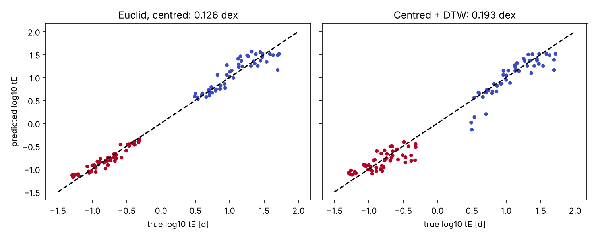

# microlensing-dtw

Which time-series similarity respects the physics of gravitational microlensing?

This mini-project applies methods from the ENSAI course *Machine Learning for Time Series* (DTW, soft-DTW, nearest-neighbour models) to simulated Roman-like light curves: constant stars, variable stars, stellar microlensing events, free-floating-planet (FFP) events with finite-source effects, and stellar flares.

**Main finding:** for microlensing, a good similarity must be **shift-invariant but not stretch-invariant**. Time warping (DTW) helps classification, but it blurs the Einstein time t_E, the quantity that sets the lens mass.

## Steps

| Step | Notebook | What it does | Run |
|---|---|---|---|
| 1 | [`01_look_at_the_data`](notebooks/01_look_at_the_data.ipynb) | Simulated light curves, short events, effect of t_E, simple features | [](https://colab.research.google.com/github/Dilru1/microlensing-dtw/blob/main/notebooks/01_look_at_the_data.ipynb) |
| 2 | [`02_classification`](notebooks/02_classification.ipynb) | 5-class 1-NN: Euclidean vs. DTW variants | [](https://colab.research.google.com/github/Dilru1/microlensing-dtw/blob/main/notebooks/02_classification.ipynb) |
| 3 | [`03_tE_recovery`](notebooks/03_tE_recovery.ipynb) | Recover log₁₀ t_E with 5-NN regression | [](https://colab.research.google.com/github/Dilru1/microlensing-dtw/blob/main/notebooks/03_tE_recovery.ipynb) |
| 4 | [`04_soft_dtw`](notebooks/04_soft_dtw.ipynb) | Soft-DTW γ sweep: how much warping is acceptable | [](https://colab.research.google.com/github/Dilru1/microlensing-dtw/blob/main/notebooks/04_soft_dtw.ipynb) |

## Results

Simulation: 10-day window, 30-minute cadence (480 epochs), 1% noise. "Centred" means each curve is shifted so its peak is mid-window, which removes the time of peak t₀ without stretching time. The band is a Sakoe–Chiba radius of 12 hours.

| Distance | Step 2: 1-NN accuracy (5 classes) | Step 3: t_E error (RMSE, dex) |
|---|---|---|
| Euclidean | 70.7% | 0.197 |
| Euclidean, centred | 91.3% | **0.126** |
| DTW | **95.3%** | 0.194 |
| DTW, 12 h band | 91.3% | 0.206 |
| Centred + DTW | 94.7% | 0.193 |
| Centred + DTW, 12 h band | **95.3%** | 0.153 |

- Removing t₀ alone takes classification from 71% to 91% and gives the best t_E.
- Unconstrained DTW classifies best but loses about 50% more accuracy on t_E than shift-only alignment (0.193 vs. 0.126 dex).
- A narrow warping band keeps most of the classification gain while losing less t_E information.
- **Step 4:** with centred soft-DTW, the t_E error falls steadily as γ grows (0.258 → 0.181 dex for γ = 0.01 → 10), approaching the shift-only baseline (0.158 dex on this smaller set).



Test sets are small (150 curves in Step 2, 100 in Step 3, 50 in Step 4), so differences of about 0.01–0.02 are within noise.

## Code

- `mldtw/simulate.py`: light-curve simulator; finite-source magnification from [VBMicrolensing](https://github.com/valboz/VBMicrolensing).
- `mldtw/bench.py`: `Bench` class that computes all distances, then 1-NN classification or k-NN regression.

```python
from mldtw.simulate import make_dataset
from mldtw.bench import Bench

Xtr, ytr, _ = make_dataset(40, seed=3)
Xte, yte, _ = make_dataset(30, seed=4)
Bench(Xtr, Xte).run().classify(ytr, yte)
```

## Run locally

```bash
pip install -r requirements.txt
```
In each notebook, replace the first cell's `!pip` / `!git clone` lines with `sys.path.insert(0, "..")` and set `FIG_DIR = "../figures"`.

## Next directions

- An encoder with the right invariance built in (CNN or attention on centred, log-time curves).
- That encoder as the summary network for neural posterior estimation of (t₀, t_E, u₀, ρ).
- Binary-lens (planetary) events, Roman-like noise and gaps, and real OGLE/KMTNet light curves.

## Author

Dehiwalage Don Dilruwan
