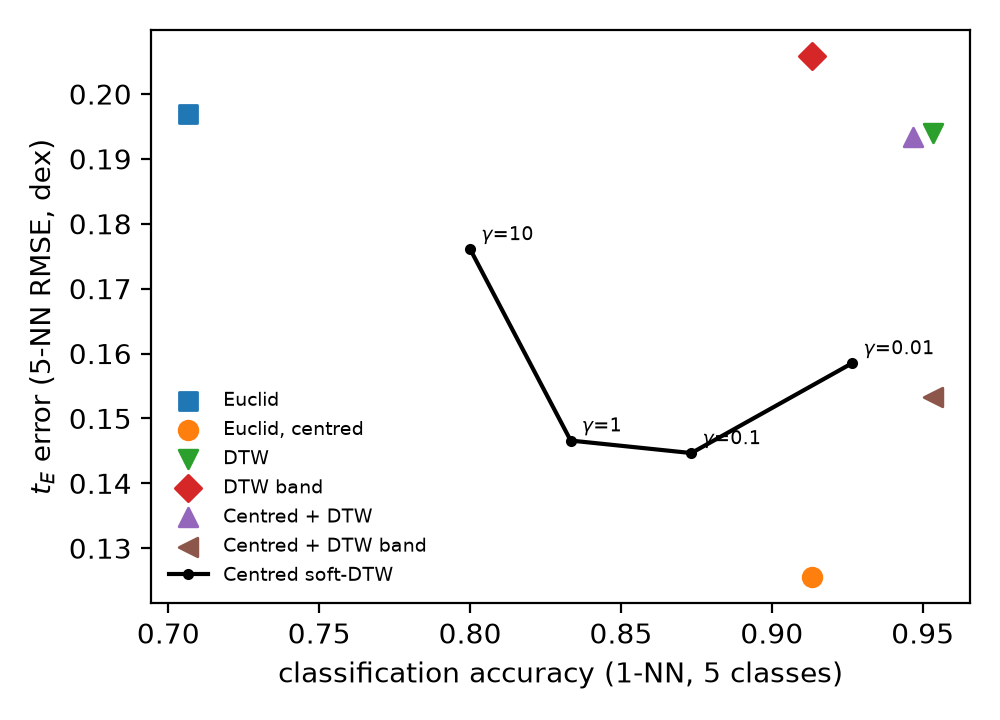

# microlensing-dtw

Which time-series similarity keeps the physics of a microlensing event?

I simulated Roman-like light curves (10 days, 30-minute cadence, 1 % noise) of five classes: constant stars, variable stars, stellar microlensing events, free-floating-planet (FFP) events with finite-source effects ([VBMicrolensing](https://github.com/valboz/VBMicrolensing)) and flares. I then compared nearest-neighbour models with the Euclidean distance, DTW and soft-DTW (methods from the ENSAI course *Machine Learning for Time Series*), on two tasks:

- classifying the five classes (1-NN, 200 train / 150 test curves),
- recovering the Einstein time $t_E$ of stellar and FFP events (5-NN regression of $\log_{10} t_E$, 300 train / 100 test events).

"Centred" means each curve is shifted so its peak is in the middle of the window, which removes the time of peak $t_0$ without stretching time. The band is a Sakoe–Chiba radius of 12 h.

## Results

| Similarity | Accuracy | $t_E$ error (dex) |
|---|---|---|
| Euclid | 70.7 % | 0.197 |
| Euclid, centred | 91.3 % | **0.126** |
| DTW | **95.3 %** | 0.194 |
| DTW band | 91.3 % | 0.206 |
| Centred + DTW | 94.7 % | 0.193 |
| Centred + DTW band | **95.3 %** | 0.153 |
| Centred soft-DTW, γ = 0.01 | 92.7 % | 0.159 |
| Centred soft-DTW, γ = 0.1 | 87.3 % | 0.145 |
| Centred soft-DTW, γ = 1 | 83.3 % | 0.147 |
| Centred soft-DTW, γ = 10 | 80.0 % | 0.176 |



DTW classifies best, but shifting alone recovers $t_E$ best: warping time also stretches the event, and the stretch is $t_E$. Soft-DTW and a narrow band lie in between. A good representation for microlensing should be shift-invariant but not stretch-invariant.

The test sets are small and use a single seed, so differences of about 0.01–0.02 dex or a few per cent are within noise.

## Code

- `mldtw/simulate.py`: light-curve simulator
- `notebooks/01_data.ipynb`: example light curves
- `notebooks/02_classification.ipynb`: 1-NN classification
- `notebooks/03_tE.ipynb`: $t_E$ regression
- `notebooks/04_tradeoff.ipynb`: figure above

```bash
pip install -r requirements.txt
cd notebooks
jupyter nbconvert --to notebook --execute --inplace 0*.ipynb
```

Notebooks 02 and 03 take about 5 minutes each (soft-DTW is the slow part).

## Author

Dehiwalage Don Dilruwan
